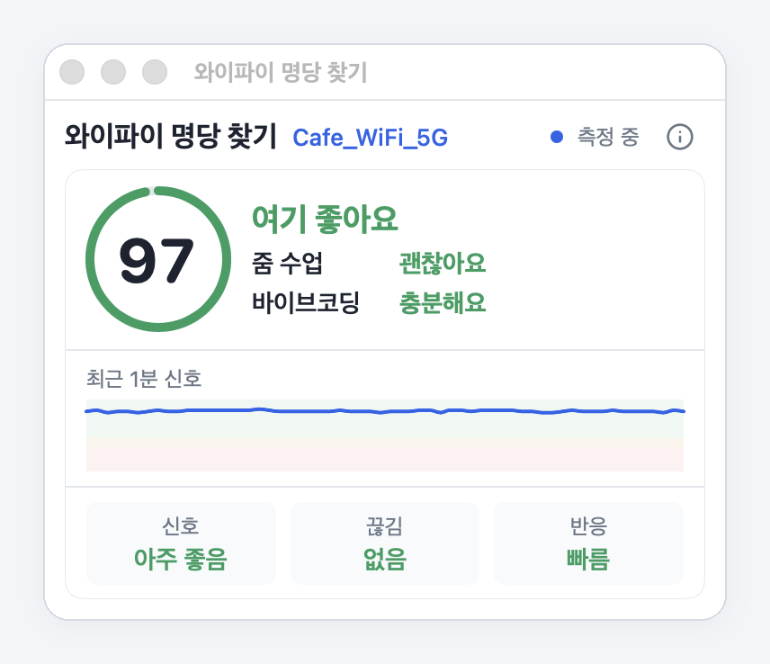
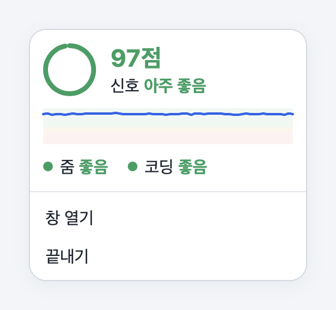
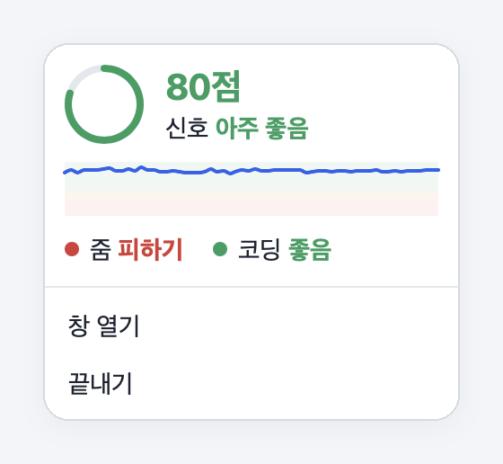

# 와이파이 명당 찾기 (macOS)

카페에서 이 자리, 줌·코딩 되나 한눈에.

맥북 들고 카페에 갔는데 와이파이가 자꾸 끊겨서 답답하셨던 분들을 위한 작은 맥 앱이에요.
지금 앉은 자리의 와이파이를 1초마다 재서, 줌 수업과 바이브코딩이 괜찮은지 말로 알려 줘요.

<p align="center">
  
</p>

## 설치

1. [Releases](https://github.com/from5302-lab/wifi-spot/releases/latest)에서 `WifiSpot-mac.zip`을 받아 압축을 풀어요.
2. `와이파이 명당 찾기.app`을 `응용 프로그램` 폴더로 옮겨요.
3. 처음 열 때 한 번만 아래 둘 중 하나를 해요. 개인이 만든 앱이라 Apple 공증을 받지 않아서 그래요.
   - 앱을 열면 "열 수 없음" 창이 떠요. 시스템 설정 → 개인정보 보호 및 보안 맨 아래에서 **그래도 열기**를 눌러요.
   - 또는 터미널에 한 줄:
     ```
     xattr -dr com.apple.quarantine "/Applications/와이파이 명당 찾기.app"
     ```

macOS 14 이상, Apple 실리콘과 인텔 맥 모두 돼요.

### 위치 권한을 묻는 이유

처음 켜면 위치 권한을 물어요. macOS는 위치 권한이 있는 앱에게만 지금 연결된 **와이파이 이름**을 알려 주거든요.
이 앱은 위치를 기록하거나 어디로 보내지 않아요. 허용하지 않아도 측정은 되고, 와이파이 이름만 '이름 숨김'으로 나와요.

## 사용법

1. 앱을 켜요. 메뉴 막대에 점수가 뜨고 창이 열려요.
2. 자리에 앉아 10~20초 기다려요. 큰 글씨가 **여기 좋아요 / 애매해요 / 피하세요** 중 하나로 정해져요.
3. 자리를 옮겨 가며 점수를 비교해요. 창을 닫아도 메뉴 막대에서 계속 볼 수 있어요.

| 창 | 메뉴 막대 |
|---|---|
|  |  |

신호가 아주 좋아도 응답이 흔들리면 줌은 '피하기'로 나와요. 신호 세기만 보면 놓치는 부분이에요.

<p align="center">
  
</p>

## 판정 기준

| | 좋음 | 애매 | 피하기 |
|---|---|---|---|
| 줌 수업: 반응(1.1.1.1까지, 최근 30초) | 100ms 미만 | 100~150ms | 150ms 이상 |
| 줌 수업: 흔들림(지터) | 30ms 미만 | 30~50ms | 50ms 이상 |
| 바이브코딩: github.com 연결 시간 | 150ms 미만 | 150~250ms | 250ms 이상 |
| 끊김(최근 60초 ping 실패, 둘 다) | 2% 미만 | 2~5% | 5% 이상 |

- 줌과 코딩은 각 항목 중 가장 나쁜 것을 따라가요.
- 판정은 같은 상태가 5초 이어져야 바뀌어요. 한 번 튄 값으로 깜빡이지 않게요.
- 점수(0~100)는 신호 40, 반응 25, 흔들림 20, 끊김 15로 나눠 매겨요.
- ping을 막아 둔 와이파이에서는 끊김을 '측정 안 됨'으로 두고 github.com 연결 시간으로 대신 봐요.
- 창 오른쪽 위 ⓘ를 누르면 dBm·ms 같은 자세한 숫자가 나와요.

## 가볍게 돌아요

- ping은 앱 안에서 직접 보내요(매초 프로그램을 새로 띄우지 않아요).
- 창이 닫혀 있으면 5초에 한 번만 화면을 고쳐요. 잠자기·화면 잠금 동안은 멈춰요.
- 우리 컴퓨터에서 잰 값: 창 열림 CPU 약 2%, 닫힘 1% 아래, 메모리 약 50MB.

## 직접 빌드

Xcode 없이 명령줄 도구(swiftc)만 있으면 돼요.

```
./build.sh            # 빌드해서 ~/Applications 에 설치
./build.sh --release  # 배포용 build/WifiSpot-mac.zip 만들기
```

빌드할 때마다 서명이 바뀌면 macOS가 위치 권한을 다시 물어요. 같은 인증서로 계속 서명하려면 `.local/signing.sh`에 `BUNDLE_ID`, `SIGN_KC`, `SIGN_ID`, `sign_unlock()`을 두세요(깃에는 안 올라가요). 없으면 ad-hoc으로 서명해요.

## 라이선스

MIT. 아이콘 일부는 [Lucide](https://lucide.dev)(ISC)예요.
